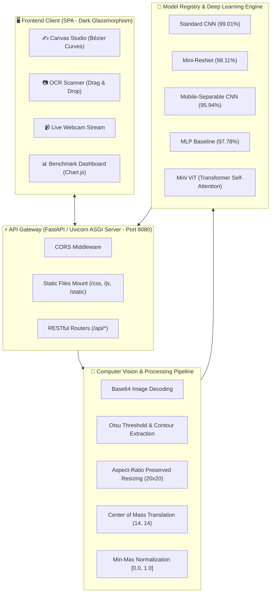

<div align="center">

# 🧠 NeuralVision Studio
### Multi-Architecture Deep Learning Benchmark & Real-Time Handwritten Digit OCR Platform

[](https://www.python.org/)
[](https://www.tensorflow.org/)
[](https://keras.io/)
[](https://fastapi.tiangolo.com/)
[](#-benchmark-leaderboard)
[](LICENSE)
[](Dockerfile)

<p align="center">
  <b>Hệ thống Trí tuệ Nhân tạo Toàn diện (Full-Stack Production Platform)</b><br>
  Đối chuẩn 5 trường phái kiến trúc mạng nơ-ron từ cổ điển đến hiện đại, tích hợp Studio vẽ tay thời gian thực, bộ quét OCR bóc tách đa chữ số và nhận diện trực tiếp qua Webcam.
</p>

[Khám Phá Tính Năng](#-tính-năng-cốt-lõi) •
[Bảng Đối Chuẩn 5 Mô Hình](#-bảng-đối-chuẩn-kỹ-thuật-5-kiến-trúc) •
[Kiến Trúc Hệ Thống](#-kiến-trúc-hệ-thống) •
[Cài Đặt & Chạy Nhanh](#-hướng-dẫn-cài-đặt--khởi-chạy) •
[API Reference](#-tài-liệu-api-endpoints)

---

</div>

## 📌 Giới Thiệu Tổng Quan

**NeuralVision Studio** là một sản phẩm học sâu và thị giác máy tính hoàn chỉnh được thiết kế theo tiêu chuẩn sản xuất (production-ready). Dự án không chỉ dừng lại ở việc thực nghiệm mô hình trên Jupyter Notebook mà đã chuyển giao toàn diện thành một ứng dụng Full-Stack hiệu năng cao:

1. **Nghiên cứu & Đối chuẩn 5 Họ Kiến trúc:** Khảo sát toàn diện ưu - nhược điểm của **Standard CNN (99.01%)**, **Mini-ResNet (98.11%)**, **MLP Baseline (97.78%)**, **Mini Vision Transformer (96.52%)**, và **Mobile-Separable CNN (95.94%)** trên tập dữ liệu chuẩn mực MNIST (60.000 mẫu train, 10.000 mẫu test).
2. **Xử lý Ảnh Chuẩn Hóa Chuyên Sâu:** Áp dụng thuật toán co giãn giữ tỉ lệ góc cạnh vào khung $20 \times 20$ và tịnh tiến theo **Trọng tâm độ sáng (Center of Mass)** vào ma trận $28 \times 28$, giải quyết triệt để vấn đề lệch nét vẽ của người dùng trên web.
3. **Máy Chủ AI Độc Lập:** Backend FastAPI bất đồng bộ (Asynchronous ASGI) với độ trễ suy luận siêu thấp (< 5ms trên CPU), sẵn sàng đóng gói Docker hoặc triển khai mạng cục bộ LAN/Wi-Fi cho điện thoại và máy tính bảng.

---

## 🌟 Tính Năng Cốt Lõi

### 1. ✍️ Studio Vẽ Tay Thời Gian Thực (Interactive Canvas)
* **Khử răng cưa & nội suy mượt mà:** Cọ vẽ khử rung bằng đường cong Bézier bậc hai, tùy chỉnh nét cọ, tẩy, hoàn tác (Undo), và xóa nhanh.
* **Suy luận kép (Single & Compare All):**
  * Chế độ đơn: Dự đoán tức thì kèm thanh đo xác suất **Softmax 10 lớp** (0-9) có hoạt ảnh mượt mà.
  * Chế độ **⚔️ So Sánh Cả 5 Mô Hình:** Đưa nét vẽ qua đồng thời cả 5 kiến trúc để đối sánh độ chính xác và độ trễ trên cùng 1 bảng.
* **AI Receptive Field (28x28):** Cho phép người dùng quan sát trực tiếp ma trận điểm ảnh mà mạng nơ-ron nhìn thấy sau khi tiền xử lý trọng tâm.

### 2. 📷 Quét Ảnh Tài Liệu & Nhận Diện Đa Chữ Số (OCR Document Scanner)
* **Phát hiện vùng ký tự tự động (Contour Segmentation):** Bóc tách các chữ số riêng lẻ trên ảnh chụp tài liệu, hóa đơn, giấy thi, bài toán viết tay.
* **Gắn thẻ Bounding Boxes phát sáng:** Vẽ hộp nhận diện màu sắc kèm nhãn dự đoán và % độ tin cậy trực tiếp lên ảnh gốc.
* **Ghép chuỗi số tự động:** Nối các chữ số theo thứ tự đọc (ví dụ: bóc tách chính xác chuỗi `2 0 2 6` với độ tin cậy trung bình **97.66%**).
* **1-Click Sample Testing:** Tích hợp sẵn các mẫu thử nhanh: `Số 7`, `Năm 2026`, `Chuỗi 8910`.

### 3. 📹 Live Webcam Scanner (Quét Trực Tiếp Qua Camera)
* Kết nối luồng video trực tiếp từ camera/webcam máy tính với khung ngắm ngắm trọng tâm.
* Bắt khung hình và đưa qua bộ tiền xử lý OCR để nhận diện chữ số trên giấy trong tích tắc.

### 4. 📊 Dashboard Đối Chuẩn Chuyên Sâu (Benchmark Hub)
* Tích hợp biểu đồ tương tác **Chart.js**:
  * So sánh Test Accuracy (%) giữa 5 mô hình.
  * Phân tích Trade-off: Độ trễ suy luận (Latency) vs Độ chính xác (Accuracy).
* Thẻ đánh giá chuyên sâu ưu điểm, nhược điểm, độ phức tạp tính toán và khuyến nghị môi trường triển khai thực tế.

### 5. 📜 Quản Lý Lịch Sử & Xuất Báo Cáo (History & Export)
* Lưu trữ tự động các lần nhận diện từ Canvas, OCR và Webcam vào LocalStorage.
* Hỗ trợ xuất dữ liệu ra file **JSON** hoặc **CSV** phục vụ báo cáo đồ án, nghiên cứu khoa học.

---

## 📊 Bảng Đối Chuẩn Kỹ Thuật (5 Kiến Trúc)

Dữ liệu thực nghiệm thu được từ quá trình huấn luyện và đánh giá công bằng 6 epochs trên tập kiểm thử độc lập 10.000 ảnh MNIST:

| Hạng | Tên Kiến Trúc Mạng | Test Accuracy (%) | Test Loss | Số Tham Số (Params) | Dung Lượng (MB) | Độ Trễ Suy Luận (CPU) | Thời Gian Train | Tỷ Lệ Lỗi (10k Mẫu) |
| :---: | :--- | :---: | :---: | :---: | :---: | :---: | :---: | :---: |
| 🥇 **1** | **Standard CNN (Classic Deep CNN)** | **99.01%** | **0.0312** | 431,914 | 5.01 MB | 0.180 ms | 99.9 s | **0.99%** (99 mẫu) |
| 🥈 **2** | **Mini-ResNet (Residual CNN)** | **98.11%** | 0.0587 | 82,058 | 1.04 MB | 0.240 ms | 161.6 s | 1.89% (189 mẫu) |
| 🥉 **3** | **MLP Baseline (Fully-Connected)** | **97.78%** | 0.0702 | 236,682 | 2.75 MB | **0.099 ms** | **7.2 s** | 2.22% (222 mẫu) |
| 4 | **Mini Vision Transformer (ViT)** | **96.52%** | 0.1052 | 71,818 | 0.95 MB | 0.304 ms | 81.4 s | 3.48% (348 mẫu) |
| 5 | **Mobile-Separable CNN (MobileNet)** | **95.94%** | 0.1206 | **21,418** | **0.31 MB** | 0.175 ms | 169.7 s | 4.06% (406 mẫu) |

### 🔍 Đánh Giá Chuyên Sâu Từng Trường Phái:
* **Standard CNN (Quán quân độ chính xác - 99.01%):** Sử dụng các khối tích chập $(3 \times 3)$ kết hợp Batch Normalization và Dropout, khai thác tối đa đặc trưng cục bộ (local patterns) và chia sẻ trọng số. Phù hợp nhất cho hệ thống máy chủ xử lý tài liệu tài chính, ngân hàng.
* **Mini-ResNet (Tối ưu gradient - 98.11%):** Sử dụng đường tắt **Skip / Shortcut Connection** ($F(x) + x$), giải quyết triệt để hiện tượng triệt tiêu đạo hàm. Số tham số chỉ bằng $1/5$ so với Standard CNN mà vẫn duy trì độ chính xác $>98\%$.
* **Mobile-Separable CNN (Vô địch về độ nhẹ - 0.31 MB):** Thay thế tích chập chuẩn bằng **Depthwise Separable Convolution** kết hợp `GlobalAveragePooling2D`. Dung lượng siêu nhỏ (**0.31 MB**) và chỉ **21.418 tham số**, là ứng viên hàng đầu để nhúng vào thiết bị IoT (Raspberry Pi, ESP32) hoặc chạy Client-side qua TensorFlow.js/ONNX Runtime.
* **Mini Vision Transformer (Self-Attention hiện đại - 96.52%):** Chia ảnh thành 49 patches $(4 \times 4)$ và tính toán ma trận Attention toàn cục. Trình diễn khả năng tiếp cận công nghệ thị giác máy tính thế hệ mới nhất.
* **MLP Baseline (Tốc độ train thần tốc - 7.2s):** Mạng truyền thẳng cổ điển. Huấn luyện siêu nhanh nhưng nhược điểm là làm phẳng ma trận (Flatten) làm mất cấu trúc không gian 2D.

---

## 🏛️ Kiến Trúc Hệ Thống



---

## 📂 Cấu Trúc Thư Mục Dự Án

```
vision/
├── .github/                            # GitHub workflows & templates
├── .gitattributes                      # Git LFS cấu hình file nhị phân lớn
├── .gitignore                          # Danh sách loại trừ chuẩn cho Python/DL
├── LICENSE                             # Giấy phép nguồn mở MIT
├── README.md                           # Tài liệu kỹ thuật dự án (English & Vietnamese)
├── requirements.txt                    # Thư viện phục vụ chạy ứng dụng (Production)
├── requirements-dev.txt                # Thư viện phục vụ huấn luyện & nghiên cứu
├── Dockerfile                          # Docker containerization config
├── docker-compose.yml                  # Docker Compose orchestration
├── run_server.py                       # CLI launcher với cấu hình linh hoạt
├── start_server.bat                    # Script khởi chạy 1-Click trên Windows
│
├── app/                                # Mã nguồn ứng dụng Full-Stack
│   ├── backend/                        # Máy chủ AI FastAPI RESTful
│   │   ├── __init__.py
│   │   ├── main.py                     # API router & middleware
│   │   ├── model_manager.py           # Quản lý vòng đời & nạp 5 mô hình
│   │   ├── image_processing.py        # Tiền xử lý ảnh chuẩn MNIST (Center of Mass)
│   │   ├── scanner_ocr.py             # Thuật toán quét bounding boxes & OCR đa chữ số
│   │   └── benchmark_data.py          # Dữ liệu & thông số đối chuẩn
│   ├── frontend/                       # Giao diện người dùng Single Page App (SPA)
│   │   ├── index.html                 # Giao diện chính
│   │   ├── css/
│   │   │   └── style.css              # Design system, glassmorphism & micro-animations
│   │   └── js/
│   │       ├── api.js                 # HTTP Client gọi API
│   │       ├── canvas.js              # Xử lý cọ vẽ & dự đoán thời gian thực
│   │       ├── scanner.js             # Quét ảnh tài liệu & vẽ bounding boxes
│   │       ├── webcam.js              # Điều khiển camera trực tiếp
│   │       ├── benchmark.js           # Khởi tạo biểu đồ phân tích Chart.js
│   │       └── app.js                 # Điều phối tabs, model selector & lịch sử
│   └── static/
│       └── samples/                   # Dữ liệu ảnh mẫu phục vụ thử nghiệm OCR
│
├── models/                             # Thư mục lưu trữ trọng số mô hình đã huấn luyện
│   ├── best_handwritten_model.keras   # Mô hình chiến thắng triển khai mặc định
│   └── saved_models_benchmark/        # Bộ 5 file mô hình Deep Learning (.keras)
│       ├── 1_MLP_Baseline.keras
│       ├── 2_Standard_CNN.keras
│       ├── 3_Mini_ResNet.keras
│       ├── 4_Mobile_Separable_CNN.keras
│       └── 5_Mini_ViT.keras
│
└── notebooks/                          # Jupyter Notebooks nghiên cứu & huấn luyện gốc
    ├── 01_mnist_architectures_benchmark.ipynb    # Quy trình huấn luyện & benchmark 5 họ mạng
    └── 02_how_machines_see_cv_exploratory.ipynb  # Khám phá cơ chế thị giác máy tính (Visual Features)
```

---

## 🚀 Hướng Dẫn Cài Đặt & Khởi Chạy

### Cách 1: Khởi động 1-Click trên Windows (Nhanh nhất)
Nhấp đúp chuột vào file:
```cmd
start_server.bat
```
*Tự động phát hiện môi trường Python 3.11, kiểm tra cổng mạng, bật máy chủ AI và tự động mở trình duyệt web.*

---

### Cách 2: Khởi động bằng dòng lệnh CLI

1. **Clone repository:**
```bash
git clone https://github.com/your-username/neuralvision-handwritten-ocr.git
cd neuralvision-handwritten-ocr
```

2. **Cài đặt thư viện phụ thuộc:**
```bash
pip install -r requirements.txt
```

3. **Khởi chạy máy chủ:**
```bash
# Khởi chạy mặc định (Port 8080, tự mở trình duyệt)
python run_server.py

# Hoặc tùy biến tham số theo ý muốn:
python run_server.py --port 8080 --host 0.0.0.0 --no-browser
```

---

### Cách 3: Chạy qua Docker & Docker Compose

Chạy máy chủ trên bất kỳ môi trường Linux/macOS/Windows nào có cài đặt Docker:
```bash
docker-compose up -d --build
```
Kiểm tra tình trạng container:
```bash
docker ps
```
Truy cập ứng dụng ngay tại: `http://localhost:8080`.

---

## 🌐 Địa Chỉ Truy Cập Dịch Vụ

Khi máy chủ khởi động thành công:
* **Giao diện Web Ứng dụng (UI):** [http://localhost:8080/](http://localhost:8080/)
* **Tài liệu Swagger API tương tác:** [http://localhost:8080/docs](http://localhost:8080/docs)
* **Tài liệu Redoc API:** [http://localhost:8080/redoc](http://localhost:8080/redoc)
* **Kiểm tra trạng thái máy chủ (Health Check):** [http://localhost:8080/api/health](http://localhost:8080/api/health)
* **Truy cập từ Điện thoại / Máy tính bảng:** Mở trình duyệt trên điện thoại và gõ `http://<IP_LAN_MAY_BAN>:8080` *(IP sẽ hiển thị trực tiếp trên màn hình terminal khi khởi chạy)*.

---

## 📖 Tài Liệu API Endpoints

Hệ thống cung cấp chuẩn RESTful API đầy đủ cho các ứng dụng bên ngoài tích hợp:

| Phương Thức | Endpoint | Mô Tả | Tham Số Đầu Vào | Định Dạng Phản Hồi |
| :---: | :--- | :--- | :--- | :--- |
| `GET` | `/api/health` | Kiểm tra trạng thái máy chủ | Không | JSON `{ status, loaded_models, ... }` |
| `GET` | `/api/models` | Lấy danh sách 5 mô hình và thông số | Không | JSON `list[ModelMeta]` |
| `GET` | `/api/benchmark` | Dữ liệu đối chuẩn & biểu đồ | Không | JSON `{ leaderboard, chart_data }` |
| `GET` | `/api/sample-images` | Danh sách ảnh mẫu test OCR | Không | JSON `{ samples: [...] }` |
| `POST` | `/api/predict/canvas` | Dự đoán nét vẽ từ Canvas | JSON `{ image, model_id, compare_all }` | JSON `{ result, comparison, preview_image }` |
| `POST` | `/api/scan/image` | Quét & bóc tách chữ số từ tài liệu | `Multipart/Form` hoặc `JSON Base64` | JSON `{ full_text, digits, annotated_image, latency_ms }` |
| `POST` | `/api/scan/webcam` | Nhận diện khung hình chụp từ webcam | JSON `{ image, model_id }` | JSON `{ full_text, avg_confidence, ... }` |

### Ví Dụ Gọi API Bằng `curl`:

**Dự đoán nét vẽ Canvas:**
```bash
curl -X POST "http://localhost:8080/api/predict/canvas" \
     -H "Content-Type: application/json" \
     -d '{"image": "data:image/png;base64,...", "model_id": "standard_cnn", "compare_all": true}'
```

**Quét ảnh tài liệu OCR:**
```bash
curl -X POST "http://localhost:8080/api/scan/image" \
     -F "file=@/duong/dan/anh_tai_lieu.jpg" \
     -F "model_id=standard_cnn"
```

---

## 🛠️ Công Nghệ & Thư Viện Sử Dụng

| Tầng Hệ Thống | Công Nghệ / Thư Viện | Mục Đích Sử Dụng |
| :--- | :--- | :--- |
| **Deep Learning** | **TensorFlow 2.16+ / Keras 3.14** | Xây dựng và huấn luyện 5 họ kiến trúc mạng nơ-ron |
| **Computer Vision** | **OpenCV 4.10, Pillow, NumPy** | Phân ngưỡng Otsu, tìm viền contour, căn trọng tâm Center of Mass |
| **Backend API** | **FastAPI, Uvicorn, Pydantic v2** | Máy chủ ASGI bất đồng bộ, xác thực schema dữ liệu |
| **Frontend UI** | **Vanilla HTML5, CSS3, ES6+ Javascript** | Không phụ thuộc framework cồng kềnh, tải trang tức thì (< 0.1s) |
| **UI Aesthetics** | **Dark Glassmorphism, Google Fonts (`Outfit`, `JetBrains Mono`)** | Giao diện hiện đại, chuyên nghiệp, hỗ trợ đa độ phân giải |
| **Data Visualization**| **Chart.js v4, FontAwesome 6** | Trực quan hóa các biểu đồ đối chuẩn tương tác |
| **DevOps** | **Docker, Docker Compose, Git LFS** | Đóng gói môi trường đồng nhất và quản lý file nhị phân lớn |

---

## 📜 Giấy Phép & Đóng Góp

* Dự án được phân phối dưới giấy phép **[MIT License](LICENSE)**. Bạn hoàn toàn có thể tự do sử dụng, chỉnh sửa và tích hợp vào các đồ án, đề tài nghiên cứu hoặc sản phẩm thương mại.
* Mọi đóng góp (Pull Request, Báo cáo lỗi Issue) đều được hoan nghênh nồng nhiệt!

---

<div align="center">
  <sub>Xây dựng và phát triển với niềm đam mê Trí tuệ Nhân tạo & Thị giác Máy tính © 2026.</sub>
</div>
